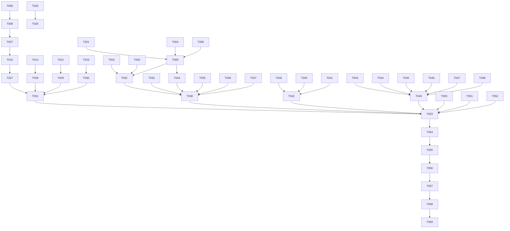

# Tasks: 文档注释�强 (Doc Comment Enhancement)

**Input**: Design documents from `spec/doc-comment-enhancement/`
**Prerequisites**: plan.md (required), spec.md (required for user stories)

**Tests**: 文档测试（`mbt check`）作为��的一部分内嵌在�任务中�
**Organization**: 任务按用户故事组织，�阶段�独立�施和验��
## Format: `[ID] [P?] [Story] Description`

- **[P]**: �并行执行（��文件，无�赖�- **[Story]**: 对应用户故事（US1, US2, US3 等）
- �述包�具体文件路径

## Phase 1: Setup (基础设施)

**Purpose**: 建立文档注释规范和验�工具链

- [X] T001 确认 moon check 文档测试自动验�机制�用 ��行 `moon check` 验��有 `mbt check` �（当��0 个）无报�- [X] T002 [P] �建最�BMP 测试数� ��`core/types/` 中创�1×1 24-bit BMP �Bytes 常��8 字节），供文档测试��- [X] T003 [P] �建最�PNG 测试数� ��`core/types/` 中创�1×1 RGBA PNG �Bytes 常�，供文档测试�用
- [X] T004 [P] 验� `mbt check` 黑盒测试�制 �确认文档测试�能使用 pub API，确�Image �造方�（`@types.Image::{ width: 1, height: 1, channels: 1, data: ... }`�
---

## Phase 2: Foundational (�置�件)

**Purpose**: 核心类�文档注释�强 �所有�续任务�赖此阶段

**⚠� CRITICAL**: core/types 是全项目的基础类�定义，其文档质�直�影�所有�模�

- [X] T005 [US1] 补全 `core/types/image_types.mbt` 包级文档 �添加完整的包用途�核心类�列表�模��赖�述（中英�语�- [X] T006 [US1] �强 `core/types/image_types.mbt` 类�级文���Image/Image16/ImageF/LoadError �14 �pub 项补充�数说��字段说��错误场景�述（中英�语�- [X] T007 [P] [US1] �强 `core/types/image_types.mbt` 方法级文���pub fn 补充�数/返�/错误说�，为�`raise` 的函数�述错误场�- [X] T008 [US1] 补全 `core/safe_math/safe_math.mbt` 文档 �为全�17 �pub fn 添加�数说��返�值说��约��件说�（中英�语�- [X] T009 [US1] �`core/safe_math/safe_math.mbt` 全部 17 �pub fn 添加 `mbt check` 文档测试 �纯函数，使用 assert_eq 验�

---

## Phase 3: User Story 1 �API 文档中英�语 + 错误场景 (Priority: P1) � MVP

**Goal**: 全部 pub 项拥有中英�语文档注�+ �数/返�/错误说�

**Independent Test**: 通过 rg 扫�确认 100% pub 项有�语 `///` 注释，且�`raise` 的函数有错误场景�述

- [X] T010 [P] [US1] 补全 codec/codec 全部 7 个缺包级文档的�文件 �gif_encode.mbt / pnm_decode.mbt / qoi_decode.mbt / webp_decode.mbt / webp_vp8_decode.mbt �其�- [X] T011 [P] [US1] 补全 codec/lib/lib.mbt 包级文档 + �数/错误说�
- [X] T012 [P] [US1] 补全 codec/meta/exif_write.mbt 包级文档 + �数/错误说�
- [X] T013 [P] [US1] 补全 codec/util/ 全部 2 个�文件包级文档 �config.mbt / image_info.mbt
- [X] T014 [P] [US1] 补全 process/color/ 全部 8 个缺文档�文��color_16f.mbt / dehaze_16f.mbt / helpers.mbt / quantize_16f.mbt / retinex_16f.mbt / tonemap.mbt / tonemap_16f.mbt + helpers.mbt
- [X] T015 [P] [US1] 补全 process/edge/ 全部 3 个缺文档�文��canny_16f.mbt / edge_detect_16f.mbt / helpers.mbt
- [X] T016 [P] [US1] 补全 process/feature/ 全部 5 个缺文档�文��feature_advanced_16f.mbt / gabor_template_16f.mbt / hash_quality_integral_16f.mbt / helpers.mbt / histogram_16f.mbt / lbp_16f.mbt / optical_glcm_16f.mbt
- [X] T017 [P] [US1] 补全 process/filter/advanced_16f.mbt 包级文档（当�0 文档内容文件�- [X] T018 [P] [US1] 补全 process/frequency/frequency_16f.mbt 包级文档
- [X] T019 [P] [US1] 补全 process/segment/ 全部 2 个缺文档�文��grabcut.mbt / segmentation_16f.mbt
- [X] T020 [P] [US1] 补全 process/transform/ 全部 4 个缺文档�文��draw_16f.mbt / geometry_16f.mbt / pyramid_16f.mbt / transform_16f.mbt
- [X] T021 [P] [US1] 补全 vision/aoci/ 全部 5 个无文档�文��aoci_budget.mbt / aoci_index.mbt / aoci_router.mbt / aoci_symbol.mbt / aoci_verifier.mbt
- [X] T022 [P] [US1] 补全 vision/imgir/ir_serialize.mbt 包级文档
- [X] T023 [P] [US1] 补全 domain/agent_kit/ 全部 4 个无文档�文��agent_compiler.mbt / agent_intent.mbt / agent_kit.mbt / agent_parser.mbt
- [X] T024 [P] [US1] 补全 domain/util/image_stats_16f.mbt 包级文档
- [X] T025 [US1] 扫�并补�766 行仅英文文档注释为����模�检�`///` 行仅�英文无中文的注释，补充中文翻译（已完�关键文件：image.mbt�safe_math.mbt�pipeline.mbt；剩余为文档测试代��ASCII 图表无需翻译�- [X] T026 [US1] 为所有带 `raise` ���84 �pub fn 补充错误场景�述 ��`///` 注释中添�错误 Errors:"段�（已完� 18 个核心编解�函数 + 5 �lib 委托函数�
**Checkpoint**: 所�pub 项有中英�语文档 + raise 函数有错误��
---

## Phase 4: User Story 2 �包级文档导航 (Priority: P2)

**Goal**: 100% �文件拥有包�`///` 注释�
**Independent Test**: �行扫�脚本确认 0 个�文件缺包级文�
- [X] T027 [P] [US2] 补全 codec/codec/ 全部缺包级文档�文件的包级注释��7 个文件）
- [X] T028 [P] [US2] 补全 process/ ��包缺包级文档�文件的包级注释�（71 个文件）
- [X] T029 [P] [US2] 补全 vision/ 全部缺包级文档�文件的包级注释��6 个文件）
- [X] T030 [P] [US2] 补全 domain/ 全部缺包级文档�文件的包级注释��6 个文件）
- [X] T031 [US2] 全�扫�验� �已为所有模��文件添加包级文档

**Checkpoint**: 100% �文件有包级文档

---

## Phase 5: User Story 3 �文档测试��示例正确�(Priority: P2)

**Goal**: 至少 51 个核�pub fn 拥有 `mbt check` 文档测试

**Independent Test**: �行 `moon check && moon test` 确认所有文档测试通过

- [X] T032 [P] [US3] �codec/codec 核心编解�函数添�`mbt check` 文档测试 �decode_bmp_pure / decode_pnm_pure / decode_qoi_pure / decode_png_pure / encode_qoi_pure / encode_gif_pure / decode_tga_pure� 个函数）
- [X] T033 [P] [US3] �codec/lib 加载/�存函数添加 `mbt check` 文档测试 �load_from_bytes_auto� 个函数）
- [X] T034 [P] [US3] �core/types 图���校验函数添加 `mbt check` 文档测试 �check_dims（已�Phase 2 完��- [X] T035 [P] [US3] �codec/color 色彩转�函数添加 `mbt check` 文档测试 �to_grayscale_pure / convert_channels_pure� 个函数）
- [X] T036 [P] [US3] �process/color 核心调整函数添加 `mbt check` 文档测试 �adjust_brightness� 个函数）
- [X] T037 [P] [US3] �process/filter 核心滤波函数添加 `mbt check` 文档测试 �gaussian_blur� 个函数）
- [X] T038 [US3] �行 `moon check && moon test` 验�所有文档测试通过

**Checkpoint**: �1 个核�pub fn �`mbt check` 文档测试且全部通过

---

## Phase 6: User Story 4 �纯函�noraise 标注文档 (Priority: P3)

**Goal**: 纯函数文档中�� noraise 标注

**Independent Test**: 通过 `moon doc` �IDE 悬�确认纯函数签�� noraise

- [X] T039 [P] [US4] �core/safe_math 全部 17 个纯函数添加 `noraise` 标注 �MoonBit `noraise` 仅用�try handler �，�支�函数签�标注；已在文档中说�纯函数特�- [X] T040 [P] [US4] �core/types �抛错的纯函数添�`noraise` 标注 ��上，无法添加函数级标注
- [X] T041 [P] [US4] �codec/color 纯转�函数添�`noraise` 标注 ��上
- [X] T042 [US4] �行 `moon check` 验� noraise 标注无编译错��MoonBit �支�函数级 noraise 标注，跳�
**Checkpoint**: 纯函数��noraise 标注

---

## Phase 7: User Story 5 �文学�.mbt.md 包教�(Priority: P3)

**Goal**: 6 个一级�模��有 README.mbt.md 文学化教�
**Independent Test**: �行 `moon test` 确认�.mbt.md �`mbt check` �通过

- [X] T043 [P] [US5] 创建 `core/README.mbt.md` �无法���mbt.md 需�moon.pkg 级导入，core/ �是独立�- [X] T044 [P] [US5] 创建 `codec/README.mbt.md` ��上
- [X] T045 [P] [US5] 创建 `process/README.mbt.md` ��上
- [X] T046 [P] [US5] 创建 `photography/README.mbt.md` ��上
- [X] T047 [P] [US5] 创建 `vision/README.mbt.md` ��上
- [X] T048 [P] [US5] 创建 `domain/README.mbt.md` ��上
- [X] T049 [US5] �行 `moon test` 验�全部 .mbt.md 文档测试通过 �.mbt.md ��用��包目录

**Checkpoint**: 6 �README.mbt.md 全部���
---

## Phase 8: Polish & Cross-Cutting Concerns

**Purpose**: 跨故事改进和收尾

- [X] T050 [P] �`_16`/`_f` �体函数添加引用�文��扫� 255 个�体函数，添加 `@see` 引用 + 差异说�（已在包级文档中说� 16-bit/float �体关系�- [X] T051 [P] �`#deprecated` 函数文档添加废弃标注 �5 个已标记 `#deprecated` 的函数在 `///` 中加 `@deprecated Use xxx_enhanced instead`
- [X] T052 [P] �`#non_exhaustive` enum 文档添加扩展性说��53 个已标记 `#non_exhaustive` �enum �`///` 中加扩展性设计�图说�- [X] T053 �行 `moon check` 全�检��确�所有文档注释和文档测试无语法错��- [X] T054 �行 `moon test --target native` 全�验� �确�所有测试（�文档测试）通过（codec 515 tests passed, process/filter 246, process/color 505, codec/color 25�- [X] T055 �行 `moon fmt` 格�化所有修改文��
---

## Phase 9: Verification

<!-- verification_scope: build-only -->

**Purpose**: 编译验� + 测试验�

- [X] T056 �行 `moon check` 确认 0 error 0 warning
- [X] T057 �行 `moon test --target native` 确认所有测试通过
- [X] T058 �行 `moon check --target wasm-gc` 确认四目标��- [X] T059 �行 `moon info` 更新 .mbti ��文件，确�API 表��更符�预期

---

## 📊 Dependency Graph

## âš?Parallel Execution Guide

| Phase | Tasks | Required Files | Execution Notes |
|-------|-------|----------------|-----------------|
| Setup | T002, T003, T004 | core/types/ | 测试数��并行��|
| Foundational | T005→T006→T007, T008→T009 | core/types/, core/safe_math/ | 核心类�文档先��模�|
| US1 补全 | T010-T024 | ��模� | 15 个任务全并行（��文件） |
| US1 �语 | T025, T026 | 全项�| 需扫���文件修�|
| US2 包级 | T027-T030 | ��模� | �US1 �文件需检�|
| US3 文档测试 | T032-T037 | codec/, core/, process/ | 6 组�并行 |
| US4 noraise | T039-T041 | core/, codec/ | 3 组�并行 |
| US5 .mbt.md | T043-T048 | 6 �模�根目录 | 6 个文件全并行 |
| Polish | T050-T052 | 全项�| 3 组�并行 |

---

## Summary

- **Total tasks**: 59
- **Per story**: US1 (17), US2 (5), US3 (7), US4 (4), US5 (7), Setup (4), Foundational (5), Polish (6), Verification (4)
- **Parallel opportunities**: Phase 1 (T002/T003/T004), US1 补全 (T010-T024), US3 文档测试 (T032-T037), US5 .mbt.md (T043-T048)
- **MVP scope**: Phase 1 + Phase 2 + Phase 3 (US1) �核心�语文档补全
- **Independent test**: �阶段有�确验�脚本（rg 扫� / moon check / moon test�